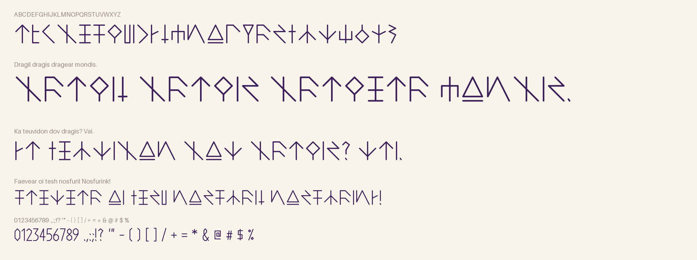
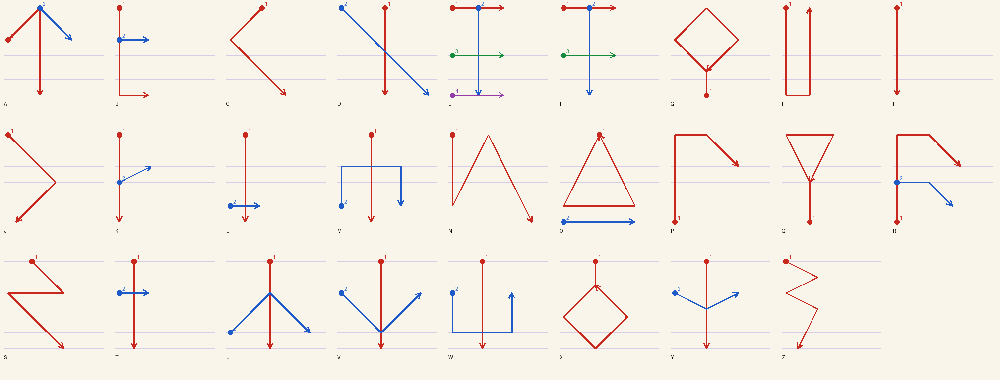

# Runetrian



Runetrian is the written script of the language of magic in
[Potion in Motion](https://store.steampowered.com/app/3481340), a game by Mystic Brew Games. In the game's lore it was
first inscribed with wands, in swift and precise strokes, and the magician Zara later standardized it into an alphabet
that is quick to write. Every letter in this font is drawn that way: one or two thin swipes of a wand, on five shared
guide lines, with nothing filled in.

## Using it

Install `fonts/ttf/Runetrian-Regular.ttf` (on Windows, open it and press Install) and type English letters: they come
out in Runetrian. Upper and lower case write the same letters. Accented letters carry their accents as small swipes
above or below the rune. Runetrian writes its numbers as words, so the digits, punctuation and symbols are plain shapes
drawn with the same wand stroke. `fonts/webfonts/Runetrian-Regular.woff2` is the same font for websites.



## Building

The source is `sources/Runetrian-Regular.ufo`, which keeps the five guide lines (cap, high, mid, low, base) as named
guidelines. Mystic Brew Games generates it from the alphabet's stroke data, so for changes to the letters themselves,
please open an issue.

```
python -m venv venv
venv/Scripts/activate          # Windows; on macOS and Linux: source venv/bin/activate
pip install -r requirements.txt
cd sources
gftools builder config.yaml    # writes fonts/ttf and fonts/webfonts
```

To check the result against Google Fonts' requirements, install [Font Bakery](https://github.com/fonttools/fontbakery)
in a separate environment (`pip install "fontbakery[googlefonts]"`) and run
`fontbakery check-googlefonts fonts/ttf/Runetrian-Regular.ttf`.

## License

This Font Software is licensed under the SIL Open Font License, Version 1.1. This license is available with a FAQ at
https://openfontlicense.org. See [OFL.txt](OFL.txt).
